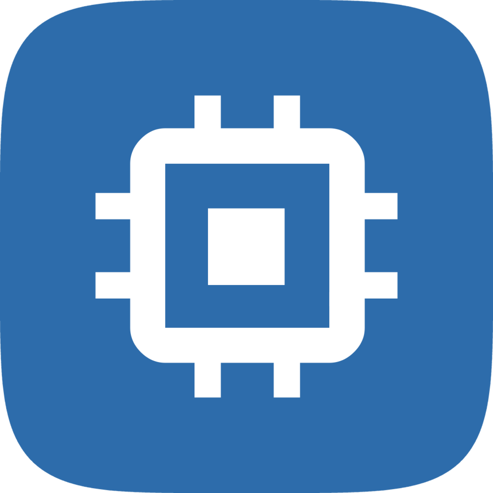
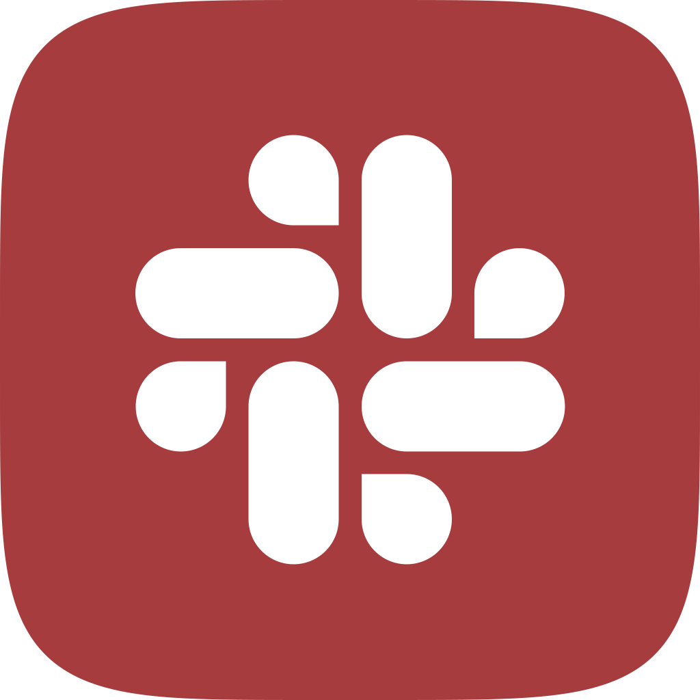

## 프로젝트

| 프로젝트                                                                     | 소개                                                                         |
| ------------------------------------------------------------------------------ | ------------------------------------------------------------------------------ |
|  [모잇 (Moit)](https://github.com/capstone-30/gd-moit) | 같은 학교 학생들이 관심 주제와 가능 시간에 맞춰 소규모 모임을 여는 모바일 웹 |
|  [SkyPort](https://github.com/capstone-30/os-scheduling) | 공항 체크인 과정을 모델링해 CPU 스케줄링 정책을 비교하는 시뮬레이터          |
|  [Slack Weather & Schedule Bot](https://github.com/capstone-30/se-slack-bot) | 날씨·강의 시간표·Google Calendar 일정을 Slack으로 전달하는 봇              |

## 팀원

<table>
  <tr><td align="center"></td><td><b>정상겸</b></td></tr>
  <tr><td align="center"></td><td><b>김준서</b></td></tr>
  <tr><td align="center"></td><td><b>안현빈</b></td></tr>
  <tr><td align="center"></td><td><b>오현근</b></td></tr>
</table>
